<div align="center">

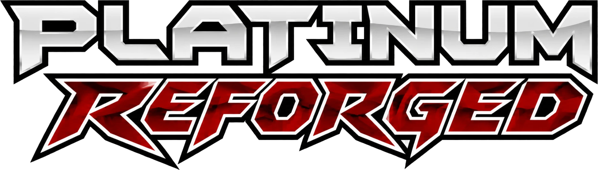

**Pokémon Platinum with BW2's battle engine.**<br>

[](https://smoldice.github.io/platinum-reforged-anvil/build/)
[](https://ko-fi.com/smoldice)

[**Download**](../../releases/latest) · [Setup](#setup) · [Options](#in-game-options) · [Troubleshooting](#troubleshooting) · [Report a problem](../../issues)

</div>

---

## What it is

Platinum Reforged is a ROM hack of Pokémon Platinum that brings in Black 2 and White 2's battle engine, and
more of Gen V along with it. The goal of this romhack is to create a Platinum experience in Gen V's more modern
graphics.

This is the home of **Platinum Reforged Anvil**, the tool that builds the game.
Anvil takes your own Platinum and Black 2 or White 2 and writes a new ROM,
*Pokemon Platinum Reforged.nds*. It runs [in your browser](https://smoldice.github.io/platinum-reforged-anvil/build/) or as a program for Windows and Linux.

## What's new

<p align="center">
  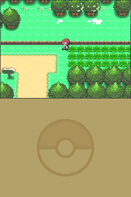<br>
  <em>A wild Pokémon on Route 201: BW2's battle engine, with Platinum's battle menus on the Touch Screen.</em>
</p>

**Gen V battles everywhere.** Wild Pokémon, trainers, double and tag battles, legendaries, the catching tutorial,
the Safari Zone, Pal Park and the Battle Frontier.

**BW2's battle backgrounds.** Routes use BW2's open-field look and dynamic backgrounds 
depending on where you are standing: lawn, dirt path, tall grass, mountain, caves, snowfields etc.

**Trainers.**
- The Sinnoh Gym Leaders and Cynthia battle with the animated sprites BW2 gave them for the Pokémon World
  Tournament.
- Trainer classes both games share, like Hiker, Youngster, Psychic, Black Belt, Lady and Swimmer, can be switched out to use BW2's
  sprites. *Togglable in the options menu.*
- **Custom sprites.** This is my attempt at keeping Platinum's aesthetic while still getting the animated battle sprites.
  I think it turned out decent if not good. For Ace Trainer, Fisherman, Worker, Lass and Waitress trainers I recolored and/or retextured BW2's
  sprites and animations to look like their Platinum counterparts. For Roughneck, Clown and Aroma Lady I animated their already existing battle sprites.
  I'll try to add more as I go.
  *Togglable in the options menu.*

*Retextured: BW2's sprites and animations, in Platinum's look.*

| | Platinum | BW2 | Retextured | Overworld |
| --- | :---: | :---: | :---: | :---: |
| **Lass** | 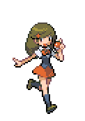 | 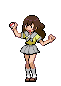 | 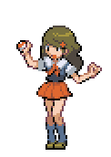 | 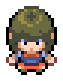 |
| **Fisherman** | 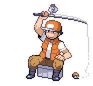 | 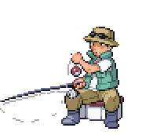 | 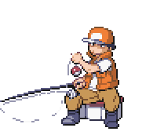 | 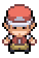 |

*Animated: Platinum's own sprites.*

| | Platinum | Animated | Overworld |
| --- | :---: | :---: | :---: |
| **Roughneck** | 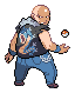 | 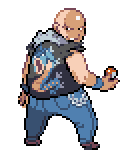 | 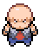 |
| **Aroma Lady** |  |  | 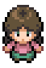 |

**More of Gen V.** BW2's transitions into battle, its evolution and egg-hatching scenes, and its 
Critical Health! Low HP Theme. *All togglable in the options menu.*

**Platinum's battle menus, recreated.** Since the game now uses BW2's battle engine, it came bundled with its battle UI on the bottom screen as well.
I retextured it to look as close as possible to Platinum's battle UI, but if you notice some differences, that is why. Still, if you prefer having BW2's UI,
you can configure this in the options menu.


## In-game options

The OPTIONS menu has seven new settings. Each one picks between Gen V and Platinum, so you can play with as much
or as little of Gen V as you like.

| Option | What it changes | Starts at |
| --- | --- | --- |
| TRAINERS | How trainers look in battle and on the overworld | PLATINUM |
| BATTLE MENUS | The look of the battle menus on the Touch Screen | PLATINUM |
| CUSTOM SPRITES | The custom sprites and animations for Gen IV trainers | ON |
| TRANSITIONS | How battles start from the overworld | GEN V |
| EVOLUTION | The evolution scene | GEN V |
| EGG HATCHING | The egg-hatching scene | GEN V |
| LOW HP | BW2's pinch music, or Platinum's beep, when your Pokémon's HP is low | GEN V |

## Planned features

- **Level caps** before each Gym. *Togglable.*
- **Exp. Share for the whole team**, the modern way: your whole party gets experience. *Togglable.*
- **Experience for catching Pokémon.** *Togglable.*
- **A difficulty setting.**
- More to come!

## What you need

1. **Pokémon Platinum (USA)**, Rev 0 or Rev 1, as an `.nds` file (game code `CPUE`).
2. **Pokémon Black Version 2** or **Pokémon White Version 2** (USA, Europe), as an `.nds` file (game codes `IREO` and
   `IRDO`). "NDSi Enhanced" dumps are fine.
3. A recent web browser, or **Windows 10 or 11**, or **Linux**.

Both ROMs must be clean, unmodified dumps of your own cartridges. Trimmed dumps work.

> **Why two games?** Every Gen V piece of Platinum Reforged (the engine, sprites, backgrounds, music) comes from
> Black 2 or White 2.

## Setup

### In your browser

1. Open [Anvil in your browser](https://smoldice.github.io/platinum-reforged-anvil/build/).
2. Choose your Platinum ROM and your Black 2 or White 2 ROM: click **Choose...**, or drop both files onto the
   page.
3. Click **Build Platinum Reforged**, then **Save the ROM**.

Your ROMs never leave your computer: the page builds the game there. The first time, your browser downloads
about 15 MB to run Anvil, and a build takes about a minute.

### Windows

1. Download **`Platinum-Reforged-Anvil-<version>-Windows.zip`** from the [latest release](../../releases/latest)
   and unzip it.
2. Open **`Platinum Reforged Anvil.exe`**.
3. Choose your Platinum ROM and your Black 2 or White 2 ROM: click **Choose...**, or drop both files onto the
   window and Anvil puts each one in its slot.
4. Click **Build Platinum Reforged**.

> Windows may say *"Windows protected your PC"* the first time, because Anvil isn't signed. Click **More info**,
> then **Run anyway**.

### Linux

On Linux, Anvil is a command-line program. Download **`Platinum-Reforged-Anvil-<version>-Linux.tar.gz`** from
the [latest release](../../releases/latest), then in a terminal, in the folder you saved it to:

```sh
tar -xzf Platinum-Reforged-Anvil-<version>-Linux.tar.gz
cd "Platinum Reforged Anvil <version>"
./platinum-reforged-anvil --platinum "Platinum.nds" --black2 "Black 2.nds"
```

### Command line (both)

The same build without the window. On Windows, it's **`platinum-reforged-anvil.exe`**, in the same zip as the app.
On Linux, it's the program above.

```sh
platinum-reforged-anvil --platinum "Platinum.nds" --black2 "Black 2.nds" --out "Platinum Reforged.nds"
```

- `--white2` works the same way as `--black2`.
- `--out` is optional. Without it, the new ROM goes next to your Platinum ROM.
- `platinum-reforged-anvil --identify "some rom.nds"` tells you what a ROM is and whether Anvil accepts it.

## Troubleshooting

**"... doesn't match a clean copy of the game"**<br>
That ROM has been changed (patched, or saved over by a tool) or is a bad dump. Dump the cartridge again, or use
another clean copy.

**Your antivirus removes or blocks Anvil**<br>
Programs packaged the way Anvil is are sometimes flagged by mistake. If you downloaded it from this repository's
releases, restore it and allow it.

**The window doesn't open (Windows)**<br>
The app needs the Microsoft Edge WebView2 Runtime, which Windows 10 and 11 usually have already. Install it from
Microsoft, or use the command-line program, which doesn't need it.

**"Permission denied" when starting it (Linux)**<br>
Make it runnable with `chmod +x platinum-reforged-anvil`.

Still stuck, or found a bug in the game? [Open an issue](../../issues). Say which version of Anvil you used, which
ROMs you gave it (the output of `--identify` helps), and what happened.

## FAQ

**Can I download the finished ROM instead?**<br>
No. Platinum Reforged is only available through Anvil, built from games you own.

**Can I keep playing my Platinum save?**<br>
Yes. Platinum Reforged works with your original Platinum save. If future features need changes an original save can't
hold, you will be able to opt out of these in the anvil tool.

## Source code

Anvil is open source, under the MIT License. [Its source](../../) is on GitHub, and
[DEVELOPING.md](../../blob/main/DEVELOPING.md) says how to run and build it. Also refer to: [LICENSE.md](../../blob/main/LICENSE.md).

## Credits

Platinum Reforged is built on the work of the Pokémon decompilation community:

- [pret/pokeplatinum](https://github.com/pret/pokeplatinum), the Pokémon Platinum decompilation.
- [pokebw2](https://github.com/fuddlesworth/pokebw2), the Pokémon Black 2 and White 2 decompilation.

Anvil is made with [Python](https://www.python.org/), [pywebview](https://pywebview.flowrl.com/),
[Pillow](https://python-pillow.org/) and [PyInstaller](https://pyinstaller.org/), and runs in the browser with
[Pyodide](https://pyodide.org/). Their licences are in *NOTICES.txt*, which comes with each download, and on the
site's [notices](https://smoldice.github.io/platinum-reforged-anvil/notices/) page.

## Disclaimer

Platinum Reforged is a free, unofficial fan project. It is not affiliated with, endorsed by or sponsored by Nintendo,
Game Freak, Creatures Inc. or The Pokémon Company. Pokémon and all related names are trademarks of their respective
owners. This repository contains no ROMs or game files; the pictures of the game in this README are only examples.
Use only games you own.

Platinum Reforged was made with the help of [Claude](https://claude.ai), Anthropic's AI model, which wrote much of
the code and tools under my direction. The ideas, design choices and playtesting are mine.
