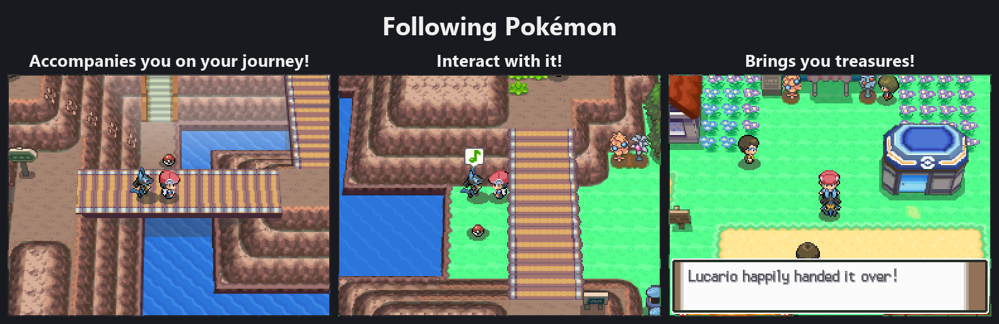
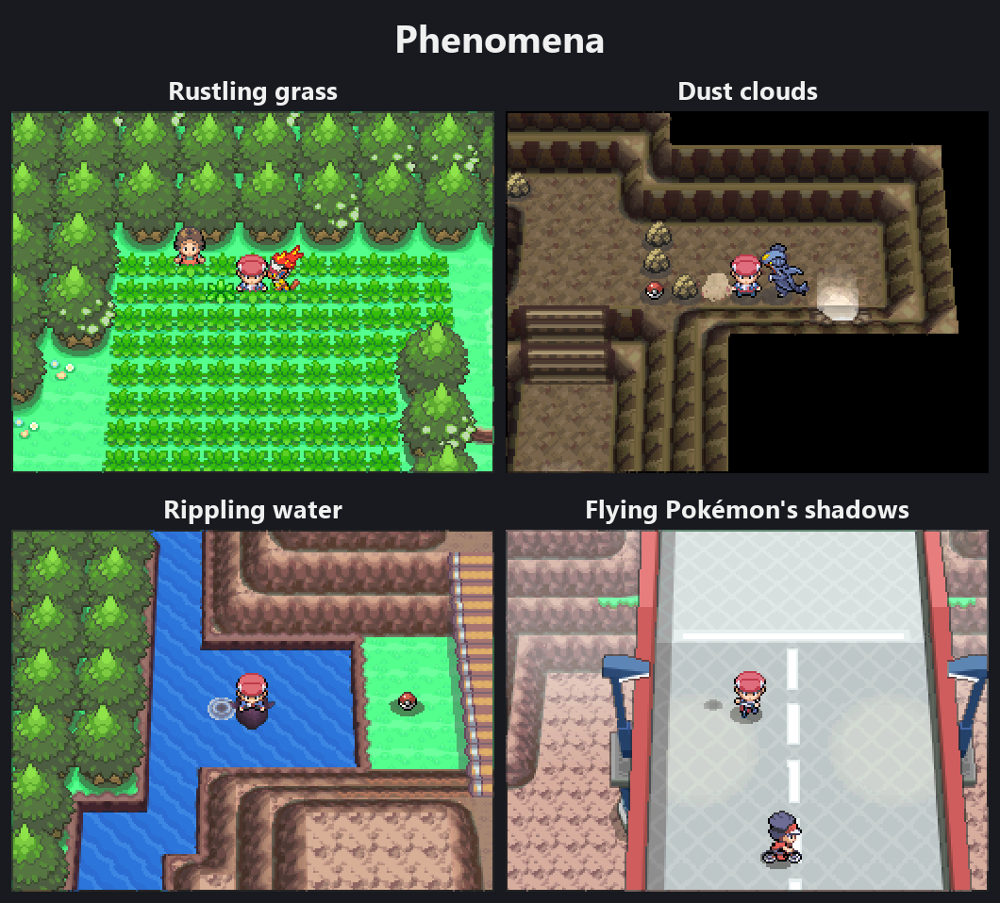
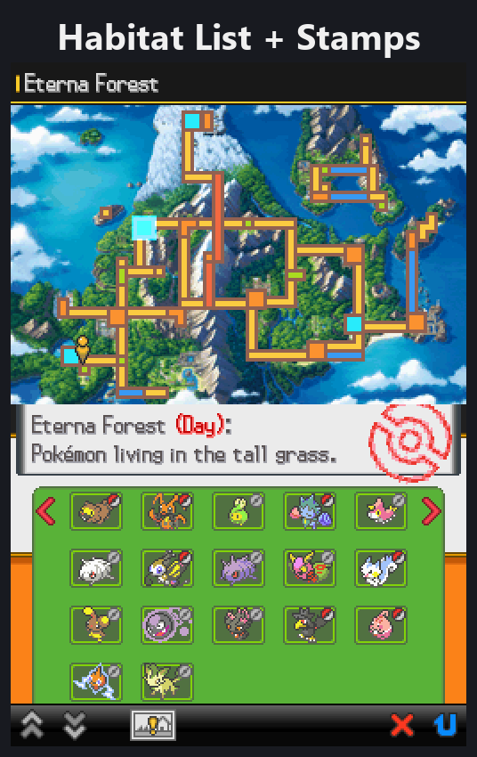
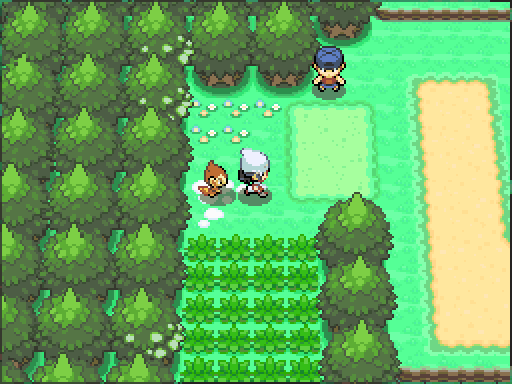
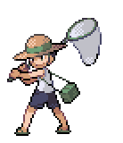
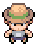

> [!NOTE]
> **A heads-up: this was made with AI.** Nearly all of it (the code, the tools, the reverse engineering, the docs)
> was written by Claude, Anthropic's AI, through Claude Code, with me directing, testing and reviewing every step.
> I'm a huge Platinum fan and built this for myself.
> If AI-made projects aren't your thing, that's totally fair: feel free to pass on this one.

> [!IMPORTANT]
> **Platinum Reforged is on Hackdex: [get it there](https://www.hackdex.app/hack/pokemon-platinum-reforged).**
> New releases come out on Hackdex as patches. Each one is still posted under [Releases](../../releases) here, with
> a link to its Hackdex page, but without Anvil's files: Anvil doesn't build the new versions.

**Pokémon Platinum with BW2's battle engine.** 

[How to play](#how-to-play) · [Options](#in-game-options) · [Troubleshooting](#troubleshooting) · [Report a problem](../../issues)

---

## What it is

Platinum Reforged is a ROM hack of Pokémon Platinum that brings in Black 2 and White 2's battle engine, and
more of Gen V along with it. The goal of this romhack is to create a Platinum experience in Gen V's more modern
graphics.

## New in 0.2.0

This one ended up way bigger than I planned lol. Thanks to everyone who played the first alpha and sent me bug
reports!

**Following Pokémon.** Your lead follows you around, with the whole HGSS system ported over: talk to it, mood
emotes, and if it likes you it'll gift you stuff (fashion accessories, Shiny Leaves, etc).

> **You need your own HeartGold or SoulSilver (USA) ROM for this.** This is optional, otherwise you just get the
> game without followers.

  

**BW2's Phenomena.** Rustling grass, dust clouds, shadows and rippling water, with rarer Pokémon and items in them.
Pokémon that normally only come to honey trees can now also be found in the rustling grass around the tree, so no
more slathering honey and waiting a whole day for that Munchlax! Some special Pokémon have their own spots too: you
might find Leafeon near the Moss Rock, Glaceon near the Ice Rock, Rotom around the Old Chateau, Spiritomb on Route
209, and Drifloon at Valley Windworks on any day of the week, not just Fridays. Even some Diamond and Pearl
exclusives like Murkrow and Stunky are out there!

  

**BW2's Pokédex + habitat stamps.** After your first badge you get the Habitat List: every area in Sinnoh and
what lives there. See everything in an area for a stamp, catch everything for another, finish it completely for a
little fanfare. Go fill that map! There are also four NPCs around Sinnoh who'll reward you for completing their
area. Not telling you who or where ;)

  

**BW2 Engine Battles** also follow Platinum's rules now. On the first release, all the battle logic and calculations
were still running on BW2's battle engine; now it's properly using Platinum's (for the most part). Plus a few more
custom sprites!

**New options.** Level caps, modern exp share, fast forward, always run and instant text. All toggleable, see
[In-game options](#in-game-options) below.

**And some smaller stuff:** BW2's registration screen when you catch something new, a save select that shows your
party, names like Bidoof instead of BIDOOF, and its own icon on the DS menu.

Still an alpha, so expect things to break!

## What's in it

   
  <em>A trainer battle on Route 202: BW2's battle engine.</em>

**Gen V battles everywhere.** Wild Pokémon, trainers, double and tag battles, legendaries, the catching tutorial,
the Safari Zone, Pal Park and the Battle Frontier.

**BW2's battle backgrounds.** Routes use BW2's open-field look and dynamic backgrounds
depending on where you are standing: lawn, dirt path, tall grass, mountain, caves, snowfields etc.

**Trainers.**
- The Sinnoh Gym Leaders and Cynthia battle with the animated sprites BW2 gave them for the Pokémon World
  Tournament.
- **Custom sprites.** This is my attempt at keeping Platinum's aesthetic while still getting the animated battle sprites.
  I think it turned out decent if not good. For Ace Trainer, Fisherman, Worker, Lass, Waitress, Black Belt, Hiker,
  Psychic, Rich Boy, Gentleman and Youngster I recolored and/or retextured BW2's sprites and animations to look like their
  Platinum counterparts. For Roughneck, Clown, Aroma Lady, Picnicker and Bug Catcher I animated their already
  existing battle sprites. I'll try to add more as I go.
  *Togglable in the options menu.*
- Every other trainer keeps their Platinum sprite, in battle and on the overworld.

*Retextured: BW2's sprites and animations, in Platinum's look.*

| | Platinum | BW2 | Retextured | Overworld |
| --- | :---: | :---: | :---: | :---: |
| **Lass** |  |  |  |  |
| **Fisherman** |  |  |  |  |

*Animated: Platinum's own sprites.*

| | Platinum | Animated | Overworld |
| --- | :---: | :---: | :---: |
| **Bug Catcher** |  |  |  |
| **Aroma Lady** |  |  |  |

**More of Gen V.** BW2's transitions into battle, its evolution and egg-hatching scenes, and its
Critical Health! Low HP Theme.

**Platinum's battle menus, recreated.** Since the game now uses BW2's battle engine, it came bundled with its battle
UI on the bottom screen as well. I retextured it to look as close as possible to Platinum's battle UI, so if you
notice some differences, that is why.

## In-game options

The OPTIONS menu has these new settings, so you can play with as much or as little of Gen V and modern Pokémon as
you like. You can change any of them at any time.

| Option | What it changes | Starts at |
| --- | --- | --- |
| CUSTOM SPRITES | The custom sprites and animations for Gen IV trainers | ON |
| TRANSITIONS | How battles start from the overworld: Platinum's or BW2's | GEN V |
| LOW HP | BW2's pinch music, or Platinum's beep, when your Pokémon's HP is low | GEN V |
| EXPERIENCE | MODERN: the whole team gains Exp. Points (100% to those that fought, 50% to the rest), and catching a Pokémon gives Exp. CLASSIC: as in BW2 | CLASSIC |
| LEVEL CAPS | Your Pokémon stop gaining Exp. at the level of the next Gym Leader's strongest Pokémon, then Cynthia's for the League. No caps once you're Champion | OFF |
| FAST FORWARD | Twice the speed outside battles: while R is held (HOLD) or always (ON) | OFF |
| RUNNING | ALWAYS: run without holding B (hold B to walk). Needs the Running Shoes | HOLD |
| TEXT SPEED | Has a new speed, INSTANT, after FAST. A new game starts at FAST | FAST |

> **Changed since 0.1.** The TRAINERS, BATTLE MENUS, EVOLUTION and EGG HATCHING options are gone: trainers keep
> their Platinum sprites (plus the custom ones), the battle menus are always in Platinum's look, and evolution and egg
> hatching always use BW2's scenes.

## Planned features

- **A difficulty setting.**
- **Hidden Grottoes**, with the two starters you didn't pick.
- More custom trainer sprites.
- More to come!

## How to play

1. Get the patch from [Platinum Reforged's Hackdex page](https://www.hackdex.app/hack/pokemon-platinum-reforged).
2. Apply it to your own clean dump of **Pokémon Platinum (USA)**. The Hackdex page says which dump it takes.
3. Play the patched ROM on an emulator or a flashcart.

## Troubleshooting

Found a bug, or something went wrong? [Open an issue](../../issues). Say which version you're playing, what you
were doing, and what happened.

## FAQ

**Can I keep playing my Platinum save?** 
Yes. Platinum Reforged works with your original Platinum save, and with saves from 0.1. If future features need
changes an original save can't hold, you'll be able to opt out of them.

**I updated from 0.1 and already beat the first Gym. Do I get the Habitat List?** 
Yes. A save past that point already has it in the Pokédex.

## Credits

Platinum Reforged is built on the work of the Pokémon decompilation community:

- [pret/pokeplatinum](https://github.com/pret/pokeplatinum), the Pokémon Platinum decompilation.
- [pokeheartgold](https://github.com/ctrl-cheeb-del/pokeheartgold), the Pokémon HeartGold and SoulSilver decompilation,
  built on [pret/pokeheartgold](https://github.com/pret/pokeheartgold).
- [pokebw2](https://github.com/fuddlesworth/pokebw2), the Pokémon Black 2 and White 2 decompilation.

The Pokédex's maps of Sinnoh are based on a map from [Bulbapedia](https://bulbapedia.bulbagarden.net/).

## Disclaimer

Platinum Reforged is a free, unofficial fan project. It is not affiliated with, endorsed by or sponsored by Nintendo,
Game Freak, Creatures Inc. or The Pokémon Company. Pokémon and all related names are trademarks of their respective
owners. This repository contains no ROMs or game files; the pictures of the game in this README are only examples.
Use only games you own.

Platinum Reforged was made with the help of [Claude](https://claude.ai), Anthropic's AI model, which wrote much of
the code and tools under my direction. The ideas, design choices and playtesting are mine.
